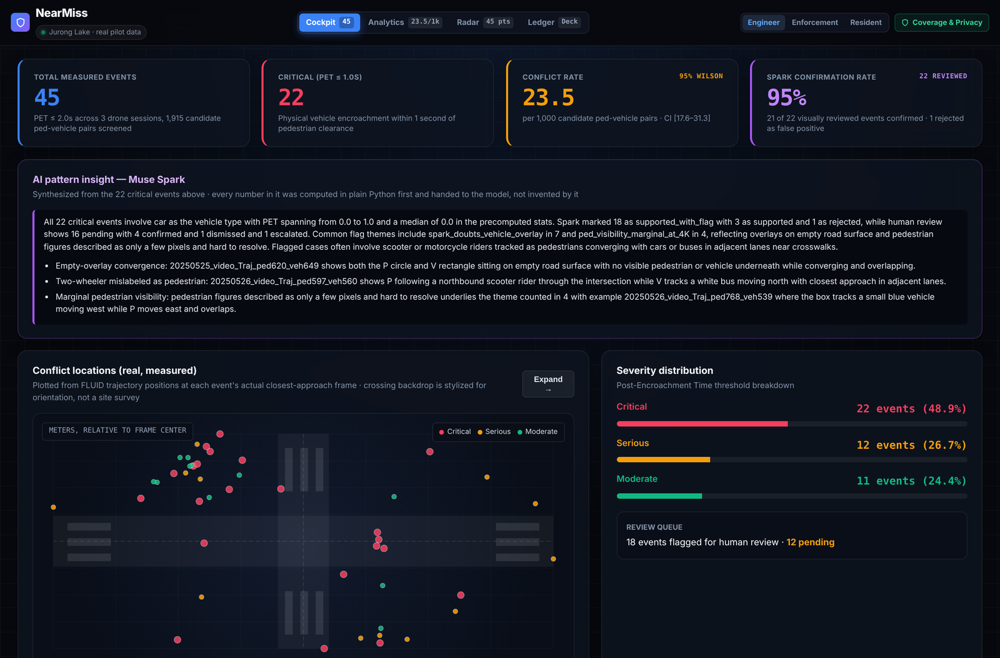
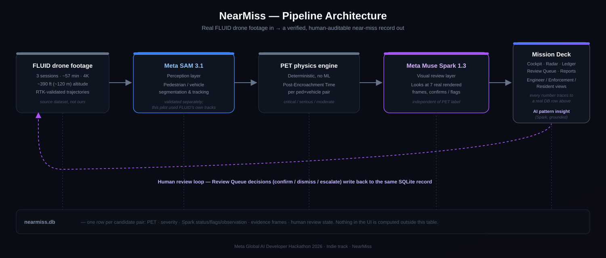

# ⚠️ NearMiss

> **See the crash before it happens.**
> Continuous intersection safety audits, powered by Meta AI.




NearMiss is a pedestrian-vehicle near-miss detection system for city traffic safety engineers. It turns any traffic camera into a continuous near-miss auditor: it detects every moment a pedestrian and vehicle come dangerously close, measures how close in metres and seconds, visually reviews each event with Meta's Muse Spark against the raw video, routes ambiguous cases to a human analyst, and produces authority-ready safety reports.

---

## 📊 Pilot Results

Validated against the public **FLUID** drone-captured intersection dataset.

| Metric | Value |
|---|---|
| Real intersection footage analysed | **~57 minutes** across 3 drone sessions |
| Pedestrian tracks reviewed | **440** |
| Vehicle tracks reviewed | **2,384** |
| Candidate interactions scored | **1,915** |
| **Near-miss events detected** | **45** (PET ≤ 2.0 s) |
| **Critical events** (PET ≤ 1.0 s) | **22** — every one visually reviewed by Muse Spark |
| Conflict rate (exposure-normalized) | **23.5 per 1,000 candidate pairs**, 95% Wilson CI [17.6, 31.3] |
| Contact-event recall vs FLUID ground truth | **100 %** |
| Match rate vs FLUID's 147 labelled conflicts | **95 %** |

### Signature end-to-end verification

All **22 critical events** get the full pipeline: physics → rendered real drone frames → Muse Spark visual review → deterministic decision. Spark never sees the computed PET or severity — only the raw frames and neutral questions. One example, session 20250526 (`ped894` × `veh871`):

1. **Physics engine** computed PET = 0.00 s, closest approach 1.37 m
2. **Rendered 7 real drone frames** (t−3 s to t+3 s) with analytical overlays
3. **Muse Spark** reviewed the real video and answered the neutral questions:
   > *"P894 moves south along the crosswalk edge while V871 moves north, and the two markers overlap at t=0.0 s. V871 appears to track a small scooter/motorcycle, while the pedestrian is only a few pixels and hard to confirm except in later frames."*
4. **Deterministic decision**: `supported_with_flag` — vehicle track confirmed, pedestrian flagged for human review (not auto-dismissed, not auto-accepted)

Across all 22: 3 `supported`, 18 `supported_with_flag`, 1 `rejected` as a false alarm — Spark genuinely disagrees with the physics-only call when the footage doesn't back it up, which is the whole point of having it in the loop.

---

## 🏗 How it works



Four stages, one evidence-grounded pipeline:

| Stage | Tech | What it does |
|---|---|---|
| **1 · Perception** | Meta **SAM 3.1** (video) | Streaming segmentation and tracking of every pedestrian and vehicle |
| **2 · Physics** | Pure Python, deterministic | Grid-based Post-Encroachment Time (0.5 m cells, vehicle footprint inflation) |
| **3 · Visual review** | Meta **Muse Spark 1.3** | Neutral visual questions, strict JSON schema — Spark never sees PET or severity |
| **4 · Human triage** | SQLite + Streamlit | Ambiguous events routed to a human analyst dashboard; `supported` / `supported_with_flag` / `rejected` / `unclear` |

The system **never** auto-accepts or auto-rejects a safety-critical event. Spark's job is to express honest uncertainty; the deterministic Python decision function combines Spark's answers with the physics to decide the event's route; the human analyst has the final say.

---

## 🖥 The dashboard

`nearmiss/dashboard.py` is a Streamlit app built around a **Mission Deck** — four tabs, all reading live from `nearmiss.db`, nothing hardcoded or mocked:

- **Cockpit** — headline KPIs: total events, critical count, exposure-normalized conflict rate with a real 95% Wilson confidence interval, Spark confirmation rate.
- **Analytics** — PET distribution, vehicle-type breakdown (as FLUID's own tracker labelled it, including a disclosed disagreement with Spark's visual read on one vehicle), per-session conflict rate table.
- **Radar** — every event plotted at its real measured world-meter location. Click any point to inspect it: measured PET, Spark status, and — for the 22 critical events — the actual rendered drone frames Spark reviewed, as a clickable filmstrip.
- **Ledger** — all 45 events in a searchable table; a 📷 badge marks the ones with a full Spark visual review.

A role switcher (Engineer / Enforcement / Resident) reframes the same data for different audiences, and a **Coverage & Privacy** panel honestly discloses: optical privacy by drone altitude, sample-size/confidence-interval caveats, what's physics-only vs. visually verified, and that position data comes from FLUID's own published tracking rather than a self-audited tracker run.

Separately, native Streamlit pages handle anything that writes to the database: a **Review Queue** for human analysts to confirm/dismiss/mark-unclear/escalate flagged events (with the same real evidence frames), and one-click **Authority Report** generation per session.

---

## 🚀 Quick start

### Prerequisites

- **Python 3.11** (CV wheels are reliable on 3.11; newer versions have hit/miss support)
- **FFmpeg** on PATH (for frame extraction / video manipulation)
- A **Meta Model API** key — [get one from dev.meta.ai](https://dev.meta.ai/)
- (Optional) **Kaggle API token** if you want to pull the TAD dataset

### Install

```bash
git clone https://github.com/Suman-Maitreya/nearmiss.git
cd nearmiss

# Create venv (Windows)
py -3.11 -m venv .venv
.\.venv\Scripts\Activate.ps1

# Create venv (macOS / Linux)
python3.11 -m venv .venv
source .venv/bin/activate

# Install dependencies
pip install --upgrade pip
pip install -r requirements.txt
```

### Set your Meta API key

```bash
# Windows (PowerShell, persistent)
setx MODEL_API_KEY "your_key_here"

# Linux / macOS
export MODEL_API_KEY="your_key_here"
```

Confirm with `python -c "import os; print('key set' if os.environ.get('MODEL_API_KEY') else 'MISSING')"`.

### Download the FLUID dataset

```bash
# From the project root
curl -L -o data/fluid/video_FIDRT.zip https://ndownloader.figshare.com/files/57459310
curl -L -o data/fluid/derived_FIDRT.zip https://ndownloader.figshare.com/files/57459280
# ... see FLUID_NOTES.md for the full list

# Extract
cd data/fluid && unzip derived_FIDRT.zip && unzip video_FIDRT.zip -d videos/
```

### Launch the dashboard

```bash
streamlit run nearmiss/dashboard.py
```

Open http://localhost:8501 — you'll see the Pilot Overview with the headline numbers.

### Reproduce the pipeline from scratch

```bash
# Validate FLUID calibration (should pass 3/3 checks)
python scripts/validate_calibration.py

# Compute PET for all 3 sessions, write to runs/ped_veh_pet_ALL.csv
python scripts/ped_veh_pet_all.py

# Build / rebuild the SQLite DB from the PET output
python scripts/build_db.py

# Validate PET engine against FLUID's 147 labelled conflicts (should match 95%)
python scripts/pet_by_conflict_type.py

# Render evidence frames + Spark review for the critical events
# (idempotent — only processes events still missing a review, safe to rerun)
python scripts/batch_review_5.py
python scripts/batch_review_remaining_sessions.py
python scripts/batch_review_20250526_remaining.py
```

Each script writes human-readable progress to stdout. The repo already ships with all 22 critical events' evidence frames pre-rendered (`runs/real_evidence_*`), so this step is optional unless you're re-deriving from scratch.

---

## 📁 Repository structure

```
nearmiss/
├── nearmiss/              # Core Python package
│   ├── physics.py           # Grid-based PET engine with vehicle footprint
│   ├── dashboard.py         # Streamlit app entry point (Mission Deck, Review Queue, Coverage, Reports)
│   ├── mission_deck.py      # Mission Deck UI — builds the live HTML from nearmiss.db, no mocked data
│   ├── report.py            # Authority report HTML generator (self-contained)
│   └── ...
├── scripts/               # Pipeline scripts
│   ├── validate_calibration.py          # §16 Step 5 gate
│   ├── ped_veh_pet_all.py               # Full dataset PET sweep
│   ├── build_event_locations3.py        # Enrich events with real (x,y) location + vehicle type
│   ├── batch_review_5.py                # Spark-review: session 20250526, first 5 events
│   ├── batch_review_remaining_sessions.py  # Spark-review: sessions 20250120 + 20250525
│   ├── batch_review_20250526_remaining.py  # Spark-review: remaining session-20250526 critical events
│   ├── pet_by_conflict_type.py          # Validation against FLUID labels
│   └── ...
├── runs/real_evidence_*/  # Rendered Spark evidence frames (22 events, ~29 MB) — shipped with the repo
├── marketing/             # Landing page (self-contained HTML)
│   └── index.html
├── config.yaml            # Pipeline thresholds (PET bands, SAM prompts, etc.)
├── requirements.txt
├── FLUID_NOTES.md         # Dataset structure findings
├── PERCEPTION_NOTES.md    # SAM 3.1 integration lessons
├── PET_ENGINE_FINDINGS.md # Physics validation results
└── README.md              # This file
```

Not in the repo (download separately):

- `data/` — FLUID (3.6 GB), TAD (13 GB) and other public datasets
- `.venv/` — virtualenv

The real Spark evidence frames (`runs/real_evidence_*`) *are* committed — the dashboard's evidence viewer needs them to work out of the box on a fresh clone. Everything else under `runs/` (intermediate CSVs, calibration scratch files) is gitignored.

---

## 🧠 Powered by Meta

| Model | Role |
|---|---|
| `meta/sam-3.1` | Video-mode segmentation + tracking of every pedestrian and vehicle. Streaming, 16 objects/frame cap, 15 k frames per request. |
| `meta/muse-spark-1.3` | Vision-grounded structured review of each candidate event. Neutral questions, strict JSON schema output, honest uncertainty. |

Both are accessed through Meta's OpenAI-SDK-compatible endpoint at `https://api.meta.ai/v1`.

---

## 📜 Data & attribution

| Dataset | Role | Licence |
|---|---|---|
| **FLUID FIDRT** ([Figshare 10.6084/m9.figshare.29974954](https://doi.org/10.6084/m9.figshare.29974954)) | Pilot source. 3 drone-captured sessions over a signalised intersection with hand-labelled vehicle-vehicle conflict ground truth. | Public research use. |
| **TAD** ([Kaggle](https://www.kaggle.com/datasets/nikanvasei/traffic-anomaly-dataset-tad)) | Separate validation of SAM 3.1 go/no-go on fixed-camera CCTV footage. | Research use; cite Zhu et al. 2020. |

Both datasets are public; neither is redistributed in this repository. The pipeline downloads them on demand.

---

## ⚠️ Limitations

- **Daytime only, one intersection, ~57 minutes total.** Absence of flagged conflicts outside the recorded windows reflects what was recorded, not that the crossing is safe at other times — see the dashboard's Coverage & Privacy panel for the full honesty disclosure.
- **23 of 45 events are physics-only.** Full Muse Spark visual review currently covers all 22 critical-severity events; the 12 serious and 11 moderate events have PET/severity from deterministic physics but no visual review yet.
- **Tracking source.** Pedestrian/vehicle positions for this pilot come from FLUID's own published, RTK-validated trajectory data — not from a SAM 3.1 run we independently audited on this footage. SAM 3.1 is validated separately (see `PERCEPTION_NOTES.md`) and is the intended perception path for footage FLUID doesn't cover.
- **Small-sample statistics.** Conflict rates are reported with a 95% Wilson confidence interval specifically because the sample (45 events, ~1,900 candidate pairs) is small enough that a point estimate alone would overclaim.
- **Calibration.** Pixel-to-metre scale is derived from FLUID's own published calibration; we did not independently re-survey the site.

## 🔒 Responsible use

- No faces or license plates are stored or shown. At the drone altitudes in this dataset (~100–120 m), they are not resolvable in the source footage — a property of the recording, not a filter we apply.
- This is **not an enforcement tool.** Every flagged event is evidence for a human traffic engineer to review, not an automated citation or liability determination.
- Every event is routed through a human-in-the-loop review queue; the system never auto-confirms or auto-dismisses a safety-critical event on its own.

---

## 🎬 Demo video

[Link to be added after recording]

---

## 🎯 Who NearMiss is for

| Audience | Use case |
|---|---|
| **City DOT traffic safety engineers** | Replace reactive crash statistics with proactive, continuous near-miss evidence that justifies infrastructure spending. |
| **Smart-city vendors** | Add a defensible safety analytics layer on top of existing camera infrastructure. |
| **Campus / facilities teams** | Monitor drop-off zones, parking-lot crosswalks, service road crossings on university or corporate campuses. |

---

## 🏆 Hackathon

Built for the **Meta Global AI Developer Hackathon 2026** (Cerebral Valley, indie track).

- Pilot site: `fluid-jurong-01` — FLUID Jurong Lake Intersection
- Pipeline follows **Architecture 2.1** (dataset-first, evidence-grounded)
- Headline claim: *"On ~57 minutes of real intersection drone footage, our pipeline deterministically detected 45 pedestrian-vehicle near-misses — 22 of them critical, every one of those independently visually reviewed by Muse Spark against the raw video — with 100% recall on physical-contact events, and every event routed through a human-in-the-loop review queue."*

---

## 📄 Licence

MIT. See [LICENSE](LICENSE).

---

Built with Muse Code · 🤖 Powered by Meta AI
